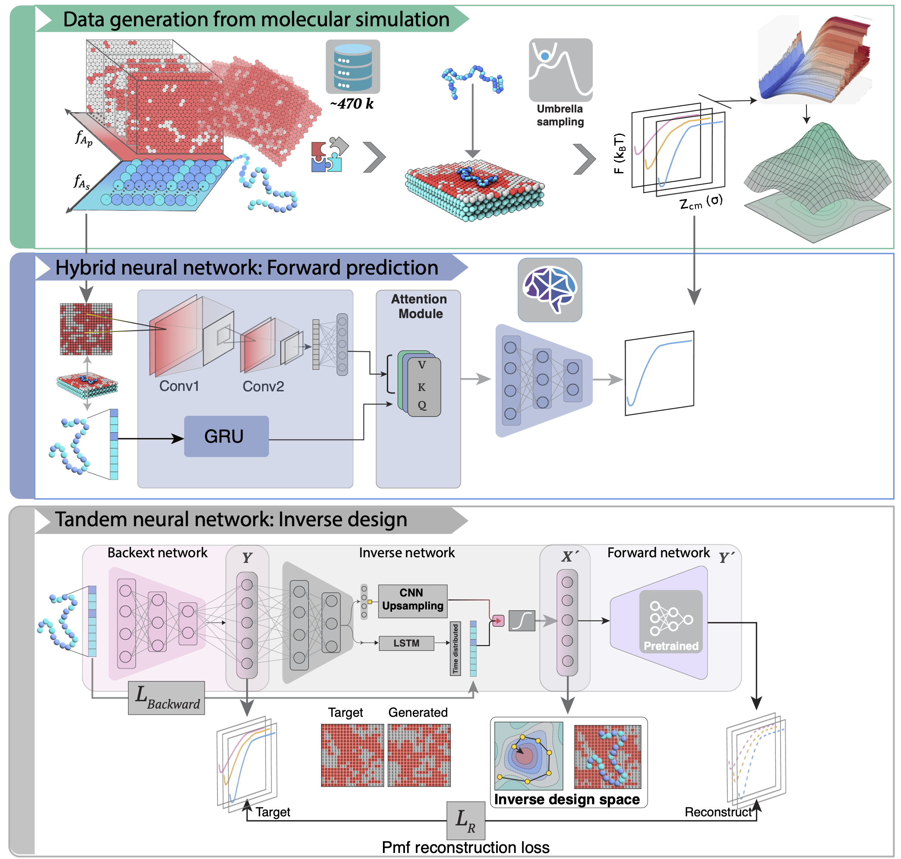
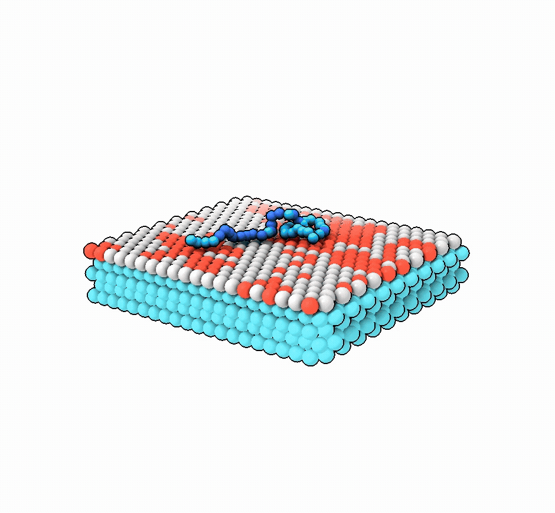
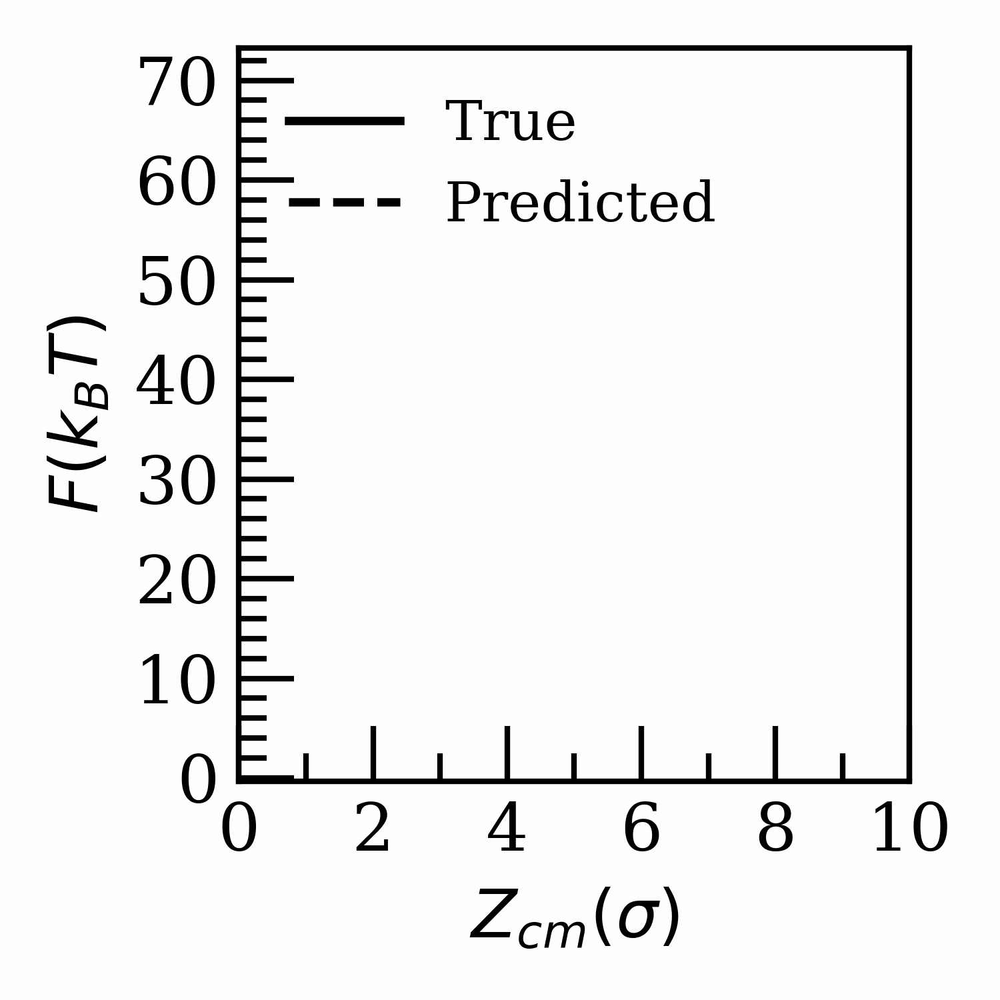
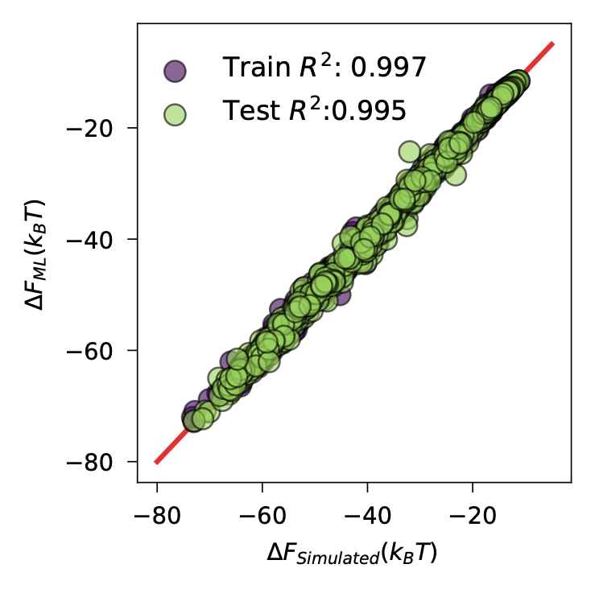

# ML_surfacepoly

Data and code for **"Prediction of Polymer Adhesion and Inverse Design of Heterogeneous Surfaces using Data-Driven Approaches"**
(S. Panigrahy, A. James, D. Nayar; *Molecular Systems Design & Engineering*, submitted).

A coarse-grained library of 92 polymer sequences and 92 chemically patterned surfaces was simulated with umbrella sampling,
giving the potential of mean force (PMF) of every polymer-surface pair. This repository contains the simulation inputs and
generators, the PMF dataset, and the models trained on it:

* **Forward model** (CNN + GRU + cross-attention): surface pattern and polymer sequence → full 100-point PMF.
* **Extended tandem network** (backext → inverse network → frozen forward model): polymer sequence and target ΔF → surface pattern.



<table>
<tr>
<td></td>
<td></td>
<td></td>
</tr>
</table>

## Repository layout

| Path | Contents |
| --- | --- |
| `mlsurfpoly/` | Python package: data pipeline (`data/`), models, losses, training loops, command-line tools (`cli/`). |
| `data/` | `raw/` simulation output (PMFs, Monte Carlo sequences and patterns), `splits/` train/validation/test tensors, `interim/` unsplit library. See [docs/data.md](docs/data.md). |
| `models/pretrained/` | Trained forward and inverse models used in the paper (`.keras`). |
| `simulation/` | Generation of polymer and surface inputs (Ising Monte Carlo), GROMACS/PLUMED set-up, umbrella-sampling and WHAM scripts. See [simulation/README.md](simulation/README.md). |
| `notebooks/` | `analysis_and_figures.ipynb`: statistics and plots of the dataset. |
| `docs/` | [Data description](docs/data.md), [model architecture](docs/architecture.md), figures. |
| `tests/` | Unit tests for the data pipeline and model construction. |

## Installation

Python 3.10-3.12.

```bash
git clone https://github.com/siba-p/ML_surfacepoly.git
cd ML_surfacepoly
python -m venv .venv && source .venv/bin/activate
pip install -e .                  # add ".[notebooks]" for the notebook, ".[dev]" for tests
```

The models were trained with TensorFlow 2.18 / Keras 3.8; `requirements.txt` lists these exact versions.

## Quick start

Predict the PMFs of the test pairs with the pretrained forward model:

```bash
python -m mlsurfpoly.cli.predict_forward \
  --checkpoint models/pretrained/forward/HybridCNN/canonical_forward_model.keras \
  --inputs data/splits/fdX_test.npy
```

Input rows have 440 binary entries: the 20 × 20 surface pattern (400 values, row-major, 0 = strongly interacting site)
followed by the 40-bead polymer sequence (0 = strongly interacting bead). Output rows are the 100-point PMF in k<sub>B</sub>T,
referenced to 0 in the unbound state, on z<sub>cm</sub> = 4.73-10.37 σ.

## Reproducing the workflow

Every step has a `make` target (see `Makefile`) and an equivalent command-line tool.

1. **Build the splits** from the raw PMF library (70/20/10 % random split over pairs, seed 11):

   ```bash
   python -m mlsurfpoly.cli.prepare_data        # writes data/splits/
   ```

   This reproduces the shipped `data/splits/*.npy` exactly (checked by `tests/test_data.py`). Surfaces are reduced to a
   canonical orientation over the 8 symmetries of the square array and polymers over chain reversal; the PMF is referenced to
   the mean of its last 10 points. Use `--symmetry rot` or `--pmf-reference raw` for the alternatives.

2. **Train the forward model**

   ```bash
   python -m mlsurfpoly.cli.train_forward --model hybrid --epochs 2000     # or --model dnn for the baseline
   ```

3. **Train the inverse design networks** (needs a trained forward model; the forward weights are frozen)

   ```bash
   make train-backward      # inverse network on top of the forward model
   make train-extended      # extended tandem network (backext + inverse + forward)
   ```

4. **Run new simulations** (optional): generate polymers and surfaces, assemble boxes and run umbrella sampling as described
   in [simulation/README.md](simulation/README.md).

Trained models and training histories are written to `models/runs/` (not tracked by git).

## Scope and limitations

* The dataset contains 91 × 91 = 8281 polymer-surface pairs used for learning (the all-weak polymer and the all-weak surface are
  excluded). The train/validation/test split is random **over pairs**: every test polymer and every test surface also occurs in the
  training set, combined with other partners. The reported accuracy therefore applies to new *combinations* of the polymers and
  surfaces of this library, not to unseen sequences or patterns. `tests/test_data.py` documents this.
* Surface sites lie on a hexagonal lattice. The 180° rotation of the 20 × 20 array maps the surface onto itself exactly; the other
  rotations and reflections preserve only about 84 % and 68 % of the nearest-neighbour contacts and are approximate symmetries.
* The model system is generic and coarse-grained (reduced Lennard-Jones units); see the paper for the mapping and the limitations.

## Citation

If you use this repository, please cite the article (see [CITATION.cff](CITATION.cff)).

## License

GNU General Public License v3.0, see [LICENSE](LICENSE).
